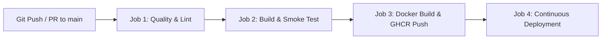

# MarketinGlu Broadcast Engine • Docker & CI/CD Production Guide

This document describes how to build, run, test, and deploy the **MarketinGlu OBS Broadcast Engine** using Docker, Docker Compose, and automated GitHub Actions CI/CD pipelines.

---

## 1. Quick Start with Docker

### A. Run via Pre-Configured NPM Workflows
```bash
# 1. Build Production Docker Image
npm run docker:build

# 2. Run Container with Environment Variables on Port 8000
npm run docker:run

# 3. Launch with Docker Compose (Background Daemon)
npm run docker:compose

# 4. Stop Docker Compose
npm run docker:compose:down
```

### B. Direct Docker CLI Commands
```bash
# Build multi-stage optimized image
docker build -t marketinglu/obs-broadcast-engine:latest .

# Run container with resource limits and restart policy
docker run -d \
  --name marketinglu_broadcast \
  --restart unless-stopped \
  -p 8000:8000 \
  -e NODE_ENV=production \
  -e PORT=8000 \
  -e HOST=0.0.0.0 \
  marketinglu/obs-broadcast-engine:latest
```

---

## 2. Docker Architecture & Security Hardening

The provided `Dockerfile` leverages a **multi-stage build architecture**:

| Stage | Image | Purpose |
| :--- | :--- | :--- |
| **Stage 1: `builder`** | `node:20-alpine` | Compiles TypeScript, bundles Vite frontend with TailwindCSS, and bundles Express backend via esbuild. |
| **Stage 2: `runner`** | `node:20-alpine` | Lean production image. Installs only production dependencies (`--omit=dev`). Excludes build tools. |

### Security & Operational Highlights
1. **Unprivileged User**: The container runs under isolated user `broadcastuser` (UID: 1001, GID: 1001) instead of `root`.
2. **Automated Healthcheck**:
   ```dockerfile
   HEALTHCHECK --interval=30s --timeout=5s --start-period=10s --retries=3 \
     CMD curl -f http://localhost:8000/health || exit 1
   ```
3. **Graceful Drainage**: Listens for `SIGTERM` / `SIGINT` signals to drain active WebSocket broadcast connections and MySQL connection pools before process exit.
4. **Timezone**: Pre-configured with `Asia/Kolkata` (Indian Standard Time - IST).

---

## 3. Local Development with Docker Compose

To run the application inside Docker with live file mounting and Vite Hot Module Replacement (HMR):

```bash
npm run docker:compose:dev
```
Or directly:
```bash
docker compose -f docker-compose.dev.yml up
```

---

## 4. GitHub Actions CI/CD Pipeline (`.github/workflows/ci-cd.yml`)

The repository features an automated GitHub Actions workflow triggered on every push or pull request to `main`:



### Pipeline Jobs Breakdown

1. **Job 1: `quality-check`**
   - Installs clean dependencies via `npm ci`.
   - Runs `npm run lint` (`tsc --noEmit`) to verify strict TypeScript type correctness across all components, API routes, and engine types.

2. **Job 2: `build-and-test`**
   - Compiles both the Vite client SPA and the esbuild server.
   - Executes automated headless server smoke test checking startup and `/health` availability.
   - Saves production build artifacts to GitHub Actions storage.

3. **Job 3: `docker-build`**
   - Sets up Docker Buildx with GitHub Actions caching (`type=gha`).
   - Builds multi-platform container image.
   - On `push` to `main`, logs into **GitHub Container Registry (`ghcr.io`)** and publishes:
     - `ghcr.io/<org>/<repo>:latest`
     - `ghcr.io/<org>/<repo>:sha-<commit>`

4. **Job 4: `deploy`**
   - Triggers deployment notification or optional webhook (`DEPLOY_WEBHOOK_URL`) for platforms like Render, Railway, CapRover, or VPS Docker Swarm.

---

## 5. Environment Variables Reference

| Variable | Default | Purpose |
| :--- | :--- | :--- |
| `NODE_ENV` | `production` | Node environment (`development` / `production`). |
| `PORT` | `8000` | HTTP & WebSocket server port. |
| `VITE_PORT` | `5173` | Vite frontend dev/preview server port. |
| `HOST` | `0.0.0.0` | Binding IP address for container networking. |
| `RAZORPAY_KEY_ID` | `rzp_test_...` | Razorpay public key for broadcast passes. |
| `RAZORPAY_KEY_SECRET` | `rzp_sec_...` | Razorpay webhook & verification secret. |
| `PAYTM_MID` | `MKTGLU_...` | Paytm Merchant Identifier. |
| `HOSTINGER_DB_HOST` | `null` | Hostinger Cloud MySQL host. |
| `HOSTINGER_DB_USER` | `null` | Hostinger MySQL database username. |
| `HOSTINGER_DB_PASSWORD`| `null` | Hostinger MySQL password. |
| `HOSTINGER_DB_NAME` | `u123..._db` | Hostinger MySQL database name. |
| `HOSTINGER_DB_PORT` | `3306` | MySQL port. |

---

## 6. Container Monitoring & Health Diagnostics

```bash
# Check container status and health probe
docker ps --filter "name=marketinglu_broadcast"

# Inspect detailed health check logs
docker inspect --format='{{json .State.Health}}' marketinglu_broadcast_app | jq

# Stream live application broadcast logs
docker logs -f --tail 100 marketinglu_broadcast_app

# Run live healthcheck probe manually
curl -i http://localhost:8000/health
```
